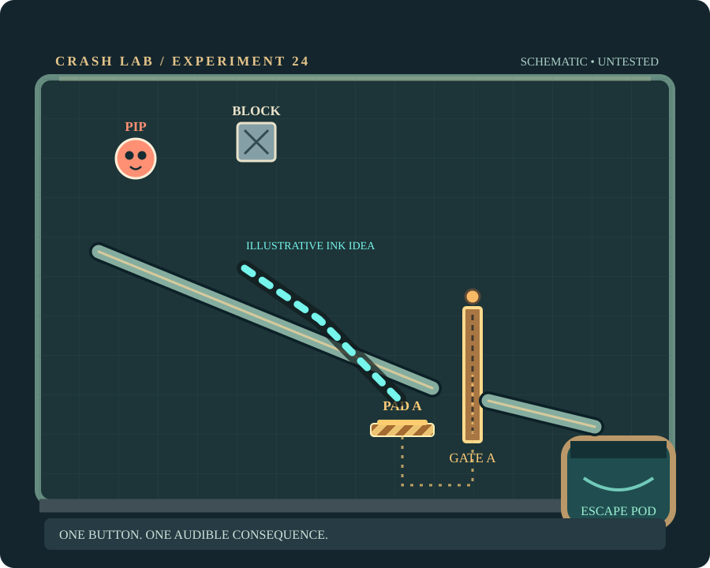
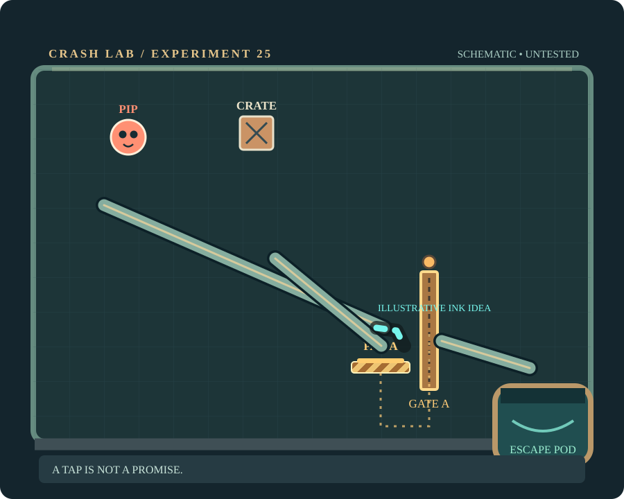
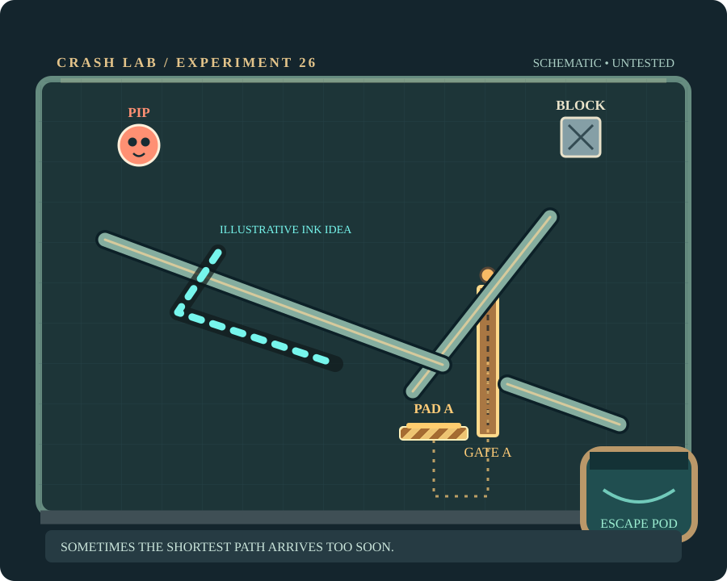
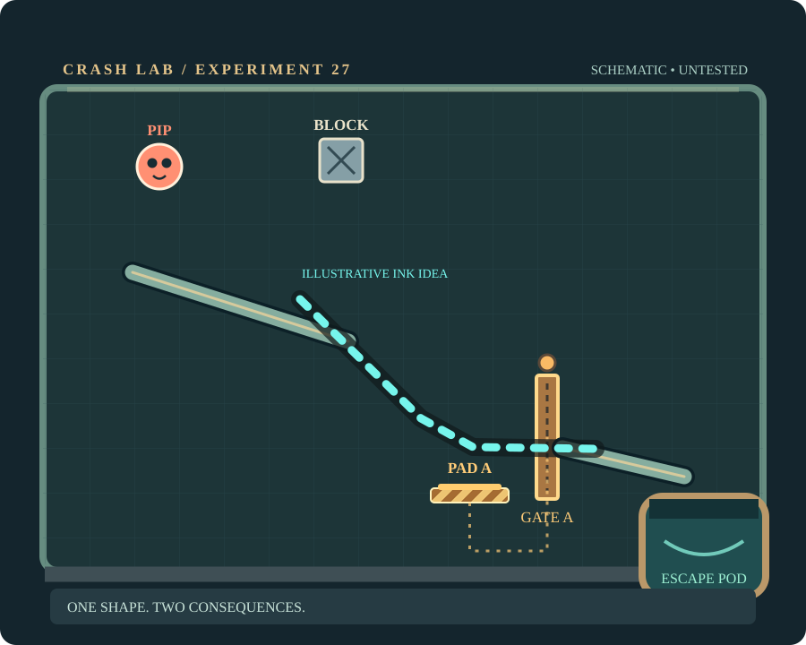
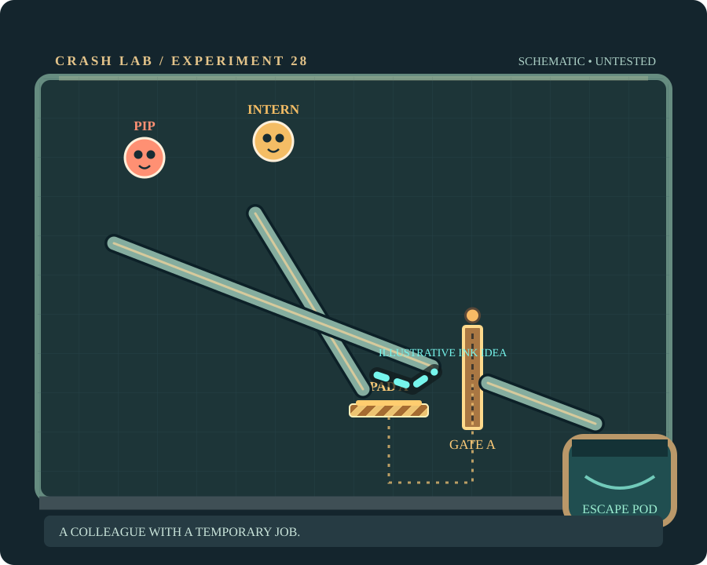
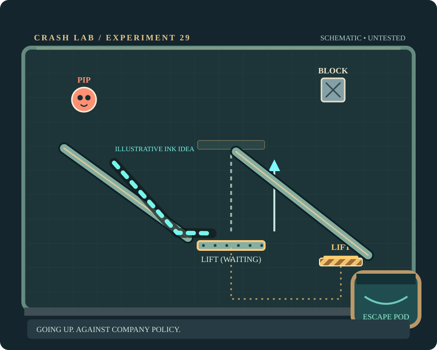
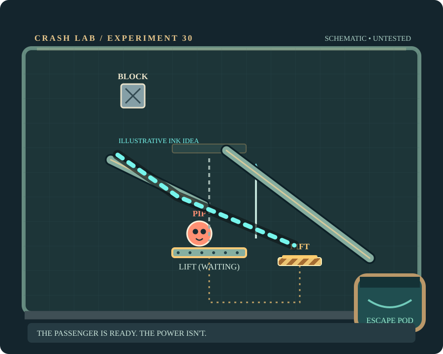
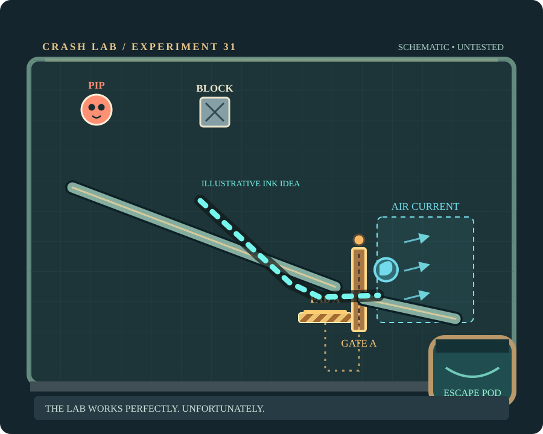

# CRASH LAB · Eight New Chambers (24–31)

**October 19, 2026 · Concept stage, NOT implemented or physics-verified**

This is an independently authored **ready-to-evaluate design packet** for Codex. It develops the approved chapter arc (switches → gates → lift) rather than redesigning Pip, expanding the screen layout or inventing a new game. Everything is authored for the existing **single continuous stroke → release → Unity 2D physics → pod** loop.

**[Open the visual design gallery](gallery.html)** · [Machine-readable concepts](levels.json) · [Codex integration handoff](CODEX_HANDOFF.md)

## Why these eight, rather than eight harder ramps?

Each requires a different player decision: *guide a block*, *park a block*, *delay a passenger*, *make one line do two jobs*, *let subjects cooperate*, *board a lift*, *power a waiting lift*, *combine gate and familiar air*. They teach a readable machine vocabulary. The challenge is conceptual, not pixel precision.

Schematic planning units: 900x720 design space; playable glass approx x=48–852, y=100–635. Rectangles are visual starting guesses only: no Unity physics validation, collision proof, measured ink budgets or 3-star pars.

## Concept gallery

| Chamber | Difficulty / role | Central question |
|---|---|---|
| **24 — Push Comes to Shove** | 2/5 · Teach | Can you send a heavy test block to a clearly marked pressure pad so Pip's prebuilt escape rail becomes usable? |
| **25 — Door Policy** | 3/5 · Variation | How can a single small drawing keep a rolling crate parked on a pad long enough for Pip to cross? |
| **26 — Waiting Room** | 3/5 · Twist | The block follows an installed slow chute toward PAD A. Can you give Pip a longer, gentler route so the gate is open when he arrives? |
| **27 — Two Jobs, One Line** | 4/5 · Aha | Can one connected ink shape catch a weight onto the pad and then make Pip's landing safely clear the opened gate? |
| **28 — The Intern Goes First** | 3/5 · Breather | Can one Pip briefly hold down the pad while the other crosses a gate, then still get both into the same collector? |
| **29 — Elevator Pitch** | 2/5 · Teach | Can you guide Pip aboard a clearly marked vertical lift while a fixed test block automatically powers it? |
| **30 — Weight of Responsibility** | 4/5 · Mastery | Pip is already waiting on the lift. Can a compact drawn guide put a falling steel block on the plate to activate it safely? |
| **31 — Chain of Command** | 4/5 · Exam | Can you shape one line so a block holds the gate, and Pip uses a familiar tailwind only after the passage is open? |

### 24 · Push Comes to Shove

**What is new:** First observable cause-and-effect: weight settles → lamp lights → hatch gate retracts. Pip's journey is mostly automated; the player learns the machinery.

**One-stroke idea:** Draw one continuous guide under the falling metal block; release and watch the pad power the gate.

**Likely wrong attempt:** A mark under Pip ignores the clearly labeled block; the gate remains closed and its lamp stays amber.

**Alternative solutions to test:** A modest diagonal supports the falling weight into PAD A. / A curved scoop directs the block without requiring an exact angle.

**Crucial risk:** Early collisions between the drawn line, installed rail and block; tune height and separate lanes. Verify block stays on PAD A without a pixel-precise stroke.

**Mechanism scope:** NEW: one reusable weight/Pip-compatible pressure pad + sliding gate + visible lamp/wire. Reuse existing SpawnWeight, rails and pod. Never bind this level to special-case id logic.

### 25 · Door Policy

**What is new:** Switch occupancy matters. The player discovers that triggering is not the same as holding: solve by catching, not by drawing a long new route.

**One-stroke idea:** Place a short stopper beside the pad; the existing steel runway gets the crate there. When it rests, the powered gate stays open.

**Likely wrong attempt:** A long ramp accelerates the crate across PAD A. The light flickers and the gate closes before Pip arrives.

**Alternative solutions to test:** Short stopper on the downhill side of the pad. / Small curved bumper that dissipates the crate's motion without bouncing it away.

**Crucial risk:** Crate center-of-mass rolling vs visually depicted contact; wide sensor collider and friction tuning required. Guard against a solution that wedges Pip on the pad.

**Mechanism scope:** REUSE pad and gate from 24. New behavior: continuous occupancy, anti-crush gate close interlock and visible occupied lamp. Do not use coded level-specific delay.

### 26 · Waiting Room

**What is new:** The player's single stroke changes time-of-arrival rather than opening a gate. The first deliberate 'wait by routing' puzzle in this chapter.

**One-stroke idea:** The weight is already guided to the plate. Draw Pip a reasonable detour before the gate, rather than racing it.

**Likely wrong attempt:** A short straight acceleration stroke gets Pip to the still-locked gate; he hits a visible, solid door.

**Alternative solutions to test:** A safe shallow bend that lengthens Pip's route. / A two-stage cradle that lets Pip descend after PAD A is visibly occupied.

**Crucial risk:** Fixed rail can override player route. Ensure the intended detour is physically attractive and differentiates early vs timely arrival in physics replay.

**Mechanism scope:** No new mechanism. Reuse hold pad and gate; only tune trajectory and relative travel distance.

### 27 · Two Jobs, One Line

**What is new:** The same physical drawing plays two roles on different sides: guided counterweight and Pip's escape deflector. Not merely solving two disconnected mini-puzzles.

**One-stroke idea:** A single continuous shape must bring the block onto the trigger and create a safe passage for Pip.

**Likely wrong attempt:** A stroke that only sends the block to the pad opens the gate but drops Pip onto the wrong side of the final gap.

**Alternative solutions to test:** A descending ramp that ends in a braking shelf. / A soft hooked stroke that still presents a support to the weight and a descent for Pip.

**Crucial risk:** Overly complicated geometry may become an exact-stroke contest. Reject and simplify if less than three broad gesture variants succeed.

**Mechanism scope:** REUSE switch/gate and native one-stroke collision. Only a level layout; do not introduce multi-stroke or material switching.

### 28 · The Intern Goes First

**What is new:** Subjects cooperate: first arrival enables passage for second. The pad is not just an object sorter; it adds a small story with recognizable lab characters.

**One-stroke idea:** The intern's fixed route brings him to the switch; guide Pip through while the circuit is held. A short shared return chute carries the intern out afterward.

**Likely wrong attempt:** If Pip races ahead or the intern leaves the plate too soon, the light goes dark and the gate blocks him; any rescue of just one still fails.

**Alternative solutions to test:** A low shared nudge for the second Pip while the first passes over the switch. / A shallow deflector that lets both join after the gate.

**Crucial risk:** Highest risk level in batch: long dwell may trap the intern and contradict two-subject rescue. A reliable exit-from-pad route is essential, not optional.

**Mechanism scope:** Only existing Pips + plate/gate. No scripted 'intern presses button' shortcut; all triggers from real Rigidbody2D contact.

### 29 · Elevator Pitch

**What is new:** First meaningful vertical travel machine. Introduce a visible lift ride, dock and short exit rail without mixing additional mechanics.

**One-stroke idea:** The block will trigger the lift. Pip needs a reliable boarding ramp; once Pip is on the platform, the lift raises him to the exit rail.

**Likely wrong attempt:** A line that sends Pip past the platform leaves him below it. A correct lift clearly waits at the lower dock rather than leaving before the player can board.

**Alternative solutions to test:** Short entry guide to the waiting lift. / Small cradle just before the lift deck that preserves forward motion.

**Crucial risk:** Coupling a kinematic vertical platform with 2D collision; ensure it does not push Pip through ceilings and that upper rail catches him with broad tolerance.

**Mechanism scope:** NEW shared vertical-lift module, reuse current carrier concept/kinematic movement, simple dock sensor. Avoid a separate cinematic or physics engine.

### 30 · Weight of Responsibility

**What is new:** Invert 29. The player controls the machine's power sequence, not boarding; the lift is already occupied and the ink must avoid disrupting passenger.

**One-stroke idea:** Pip is aboard the lift from frame one. Route the falling block into the lift circuit; use the minimal intervention to power the ride.

**Likely wrong attempt:** A giant stroke can strike Pip on the deck or send the weight across the empty floor instead of activating the lift.

**Alternative solutions to test:** Compact downhill channel from the block to the plate. / Short interception plus a prebuilt fixed rail feeding PAD L.

**Crucial risk:** Introducing a latched motor command after hold gates may confuse players. Clearly distinguish LIFT command with up-arrow + 'READY/GO', no identical plate artwork for different semantics.

**Mechanism scope:** Reuse 29's lift + a one-shot motor start on sustained pad contact (not a gate occupancy rule); visually explicit latched lift state.

### 31 · Chain of Command

**What is new:** Combines *learned* gate and existing fan in a short, observable sequence; no new trick, material or abstract control.

**One-stroke idea:** Use the line to send the block to the pad. The door opens; the air current then does the travel. Use available ink for control, not brute force.

**Likely wrong attempt:** A direct high-speed escape before powering the door runs into the locked shutter. A long ink bridge may keep Pip above the fan and overshoot.

**Alternative solutions to test:** A long but shallow connected stroke powers the switch then gives Pip a braking landing. / One short intercept can redirect weight and leave the installed rail doing most of Pip's trip.

**Crucial risk:** Too much at once if switch, gate and fan all intersect Pip draw corridor. Favor spacious board and reuse wide launch rail; reject if only microscopic line works.

**Mechanism scope:** REUSE plate, gate, fan, rail. No lift in level 31: keeps final exam focused on two learned technologies.

## Non-negotiable gates before calling any chamber playable

- All gates use actual Rigidbody2D collisions/sensors, a visibly connected brass cable and a light that accurately follows pad state. Press-and-hold differs explicitly from the lift's latched start command.
- Do not script automatic wins; all required subjects must physically enter and complete the established escape-pod capture logic.
- Never permit closing machinery to crush or trap Pip. A moving lift waits until a passenger is aboard, carries by ordinary physics and safely docks.
- Record at least **three** successful real production-input replays per level (including a rough human-like stroke); a near-offset hand stroke must still work. Also record one understandable failed idea and one boundary/tiny-stroke attempt. Iterate geometry/ink/pars from measured physics, not these unverified coordinates.
- Test release→run→pod, retry, Android Back/pause, sound, stars, short finger input, long-phone layouts and no unintended one-stroke bypass. Then test actual phone feel with users; automated replays do not certify fun.
- If 28 is unable to release the switch-holding intern and rescue both, **redesign or reject it**. Do not invent a timed door that contradicts the pressure-plate rule. If 31 is crowded, reduce apparatus, not corridor width.

## Source of truth and integration boundaries

Original private project remains `hanitaki93-create/Games` at `codex/crash-lab-mobile-v2-levels08-23`. Its current `LabLevel` supports balls, weights/crates, platforms, rails, air jets, pod, shuttle and heavy ink. **The proposed pad/gate and vertical lift are not in the current level schema:** add small reusable level-data components if and only if the first playable prototype merits them.

This public repo contains **original schematics and ideas, not private source or assets**. No edits to original Unity project, no new Pip, no added APK size, no production claim.
